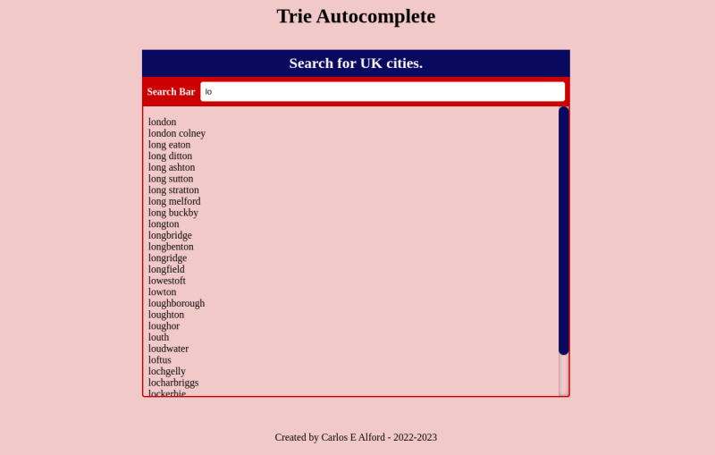

# Trie Autocomplete :wrench:

Auto complete input box which uses the Trie Tree Data Structure a.k.a. prefix tree.

## About

The demo loads over 2,000 UK cities for you to search through. Currently it just displays the city name.

:wrench: [Live demo](https://webshuriken.github.io/trie-autocomplete/)



## Tech Stack

**Client:**

- HTML
- CSS
- JavaScript

**Backend:**

- http-server

## Run Locally

1. Clone the project

```bash
  git clone https://github.com/webshuriken/trie-autocomplete
```

2. Go to the project directory

```bash
  cd my-project
```

3. Install dependencies

```bash
  npm install
```

4. Start the server

```bash
  npm run start
```

### Running Tests

To run tests, run the following command

```bash
  npm test
```

### Run Developer mode

To start developing which run a local server that reloads the browser when a file changes and also runs sass in the background so it automatically recompiles CSS on file save.

```bash
  npm run dev
```

## Features

- Auto completion box using trie

## Road Map

- [ ] Improve the suggestions
  - [ ] Give the user a choice of the max number of results to display
  - [ ] A way to keep track of the popular words and display them instead
  - [ ] Improve storage of word 

## Acknowledgements

 - [Kyle Simpson Trie Tree](https://frontendmasters.com/courses/algorithms-practice/trie-tree-data-structure/). I did not watch this frontend Masters course but I did attend a talk of his where he when through this topic.
 - [Mozilla debeloper resources](https://developer.mozilla.org/en-US/). Always super handy.
 - [SASS documentation](https://sass-lang.com/). Fantastic idea.
 - [Sarah Cope @ CSS Tricks](https://css-tricks.com/almanac/properties/s/scrollbar/). Article on scrollbar styling.

## Authors

- [Carlos E Alford](https://carlosealford.com/)

## License

[MIT](https://choosealicense.com/licenses/mit/)
